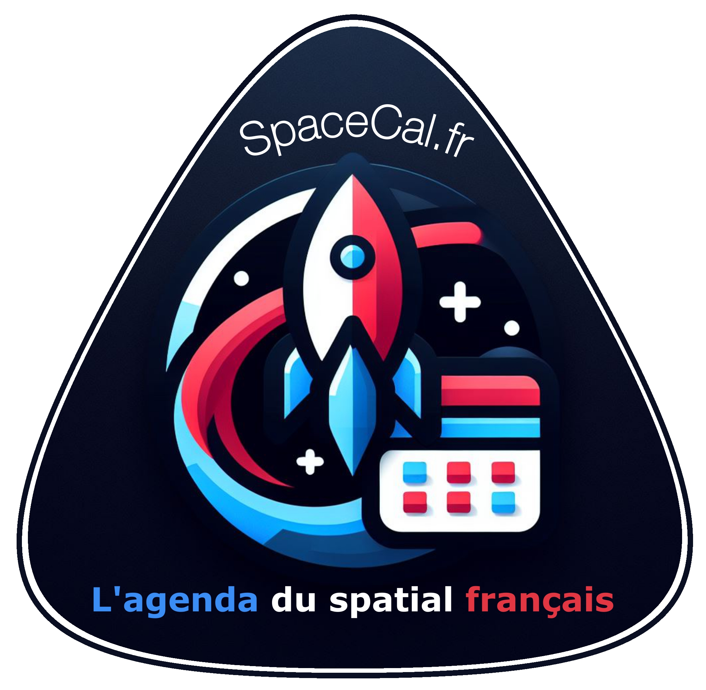

# SpaceCal-Fr - Agenda des événements du spatial du 2 au 8 novembre 2026

Bonsoir à toutes et tous,

C'est dimanche et voici votre rendez-vous hebdomadaire des nombreux et passionnants événements du spatial français de cette première semaine de novembre !

⤵️🧶❤️🛰️

## Lundi 2 novembre
4 événements [(tous les liens sur SpaceCal-Fr)](https://www.spacecal.fr) :

1. ***SKA-OSUPS-2026 : Journée SKA @ OSUPS*** : journée dédiée aux activités SKA au sein de l’OSU Paris-Saclay et qui vise à réunir l’ensemble des personnels impliqués dans le projet SKA, chercheur(e)s, ingénieur(e)s, postdoctorant(e)s et doctorant(e)s, afin de favoriser les collaborations, partager les avancées du projet et renforcer la cohésion de la communauté locale.
Début à 9h30 à l'ENS Paris-Saclay - bât. Nord - amphi Simondon, Gif-sur-Yvette (91).

2. ***Vigie OT#6 - Données d'observation de la Terre : de l'accès aux applications*** : nouvelle session des Vigies OT IRISPACE avec deux interventions : Sébastien Benitez, Siradel, "*De l'avion à l'orbite : ce que la très haute résolution satellite rend possible*", et Bertrand Legras, CNES, qui évoquera GEODES : le portail d’information et d’accès aux données d’observation de la Terre du CNES.
À 11h en ligne.

3. ***Exobiologie Jeunes Chercheurs.ses (EJC)*** : Les EJC réunissent les jeunes chercheurs et chercheuses, du Master au post-doctorat, autour de l’origine de la vie, son évolution et sa détection, sur Terre comme dans l’Univers.
L'objectif est de réunir de jeunes chercheurs et chercheuses issus de différentes disciplines (biologie, chimie, physique, astronomie, sciences de la Terre, sciences de l'environnement, etc.) et de leur offrir une plateforme pour présenter leurs travaux, échanger des idées et nouer des collaborations.
Des présentations interdisciplinaires, notamment en droit spatial et anthropologie, seront également proposées.
Jusqu'au 4 novembre au CNES Paris - Salle de l'Espace, Paris (Ier).

4. ***ACME workshop: The Transient Universe in the Rubin Era*** : 2e atelier ACME qui sera consacré aux prochaines observations de l'observatoire Rubin et à leur lien avec le ciel multilongueurs d'onde et multimessagers. 
Plusieurs observatoires seront présentés et les résultats actuels ainsi que les perspectives d'avenir pour l'observation d'une variété de sources transitoires seront abordés. 
L'atelier fournira également des informations sur les outils pouvant aider à coordonner les efforts d'observation du ciel transitoire. 
Jusqu'au 6 novembre à l'Institut Pascal, Université Paris-Saclay, Orsay (91).

## Mardi 3 novembre
3 événements [(tous les liens sur SpaceCal-Fr)](https://www.spacecal.fr) :

1. ***Quand les trous noirs sont massifs*** : par Marta Volonteri, IAP, Académie des sciences, dans le cadre des conférences publiques mensuelles de l'IAP. 
Début à 19h30 à l'Institut d’Astrophysique de Paris, Paris (XIVe), et retransmis en direct sur la chaîne YouTube de l’IAP.

2. ***4MOST : l’oeil géant qui décrypte l’Univers*** : par Florence Laurent, ingénieure de recherche en optique, et Johan Richard, astronome au Centre de Recherche Astrophysique de Lyon (CRAL), dans le cadre des conférences du Club d'astronomie Lyon Ampère (CALA).
À 19h30 au Palais du Travail (aile ouest du TNP), Villefontaine (38).

3. ***Space Age: Quand la conquête spatiale inspire le design*** : exposition pour plonger dans l'univers du Space Age, cette période où la course à l'espace a fasciné le monde et transformé le design, l'architecture et les objets du quotidien. 
Matériaux innovants, formes futuristes, esthétique rétro-futur... entre science et imaginaire, revivez l'influence des grandes aventures spatiales sur nos modes de vie, des années 60 à 80.
Vernissage le 2 novembre à 20h.
Exposition accessible les mercredis et jeudis de 14h à 22h ainsi que les soirs de spectacles à l'Espace Alphonse Daudet, Coignières (78).

## Mercredi 4 novembre
7 événements [(tous les liens sur SpaceCal-Fr)](https://www.spacecal.fr) :

1. ***InnoDay by Aerospace*** : 3e édition de ce rendez-vous annuel de l’innovation pour les membres des filières Aéronautique, Espace et Drones du Pôle Aerospace Valley.
Cette journée est une opportunité de rencontres et de découvertes pour faciliter l’innovation, l’émergence de projets et nouer de nouveaux partenariats.
Réservé aux membres du pôle.
Dès 9h à La Cité, Toulouse (31).

2. ***Vigie SO#5 - Matériaux innovants*** : nouvelle session des Vigies Systèmes Orbitaux d'IRISPACE avec deux interventions : Pierre Gautier-Le Boulch, fondateur d'Eclore, "*Structures pliées en polymères techniques : nouvelles possibilités pour les applications spatiales*", et Antoine Le Duigou, Université Bretagne Sud, "*Comment l'impression 4D peut rendre l'exploration spatiale plus soutenable ?*"
Début à 11h en ligne.

3. ***Exocomètes, 40 ans de découvertes*** : par Alain Lecavelier des Etangs, Institut d'astrophysique de Paris (CNRS), dans le cadre des conférences mensuelles du Bureau des Longitudes.
À 14h30 à l'École Normale Supérieure - Salle Jaurès, Paris (Ve).

4. ***Les Europe(s) Spatiale(s) - 2/3*** : cycle de conférences organisé par la Chaire Espace de l’ENS sous la direction scientifique de Stéphanie Ruphy et d’Alban Guyomarc’h, qui réunira chercheurs, politiques et praticiens de l’Europe spatiale.
Thème de la session : "*Perspectives plurielles sur l’Europe spatiale*".
Début à 16h à l'École normale supérieure - campus d’Ulm, Paris (Ve).

5. ***La Lune : impacts et volcans*** : par Jean-Jacques Legrand, astronome amateur du Club COPERNIC de Fréjus Saint-Raphaël, dans le cadre des conférences de la Société d'Astronomie de Cannes.
Dès 17h30 à la Maison des associations, Cannes (06).

6. ***L'astronomie en Antarctique*** : par Djamel MEKARNIA, chargé de recherche CNRS au Laboratoire Lagrange, Observatoire de la Côte d’Azur, dans le cadre des conférences de l’association Aquila.
Début à 18h à la Faculté des Sciences - Campus de Valrose - amphi informatique, Nice (06).

7. ***Coronographie et exoplanètes de Diophante à MIRI-JWST, une histoire de phase*** : par Daniel Rouan, Observatoire de Paris – Académie des sciences, dans le cadre des conférences mensuelles de la société astronomique de France (SAF), en partenariat avec le Conservatoire national des arts et métiers (CNAM) et l’union des ingénieurs du CNAM (Unicnam).
À 19h au CNAM, Paris (IIIe), et sur la chaîne YouTube de la SAF.

## Jeudi 5 novembre
4 événements [(tous les liens sur SpaceCal-Fr)](https://www.spacecal.fr) :

1. ***Brekky SpaceLy - Espace et énergie : enjeux et ambitions*** : petit déjeuner SpaceLy, le Club d’investisseurs du spatial de Connect by CNES, où les enjeux et ambitions autour de l'énergie et du spatial seront analysé sous plusieurs angles.
Au travers d’échanges et networking ce rendez-vous proposera des clefs de lecture aux investisseurs pour mieux appréhender ces sujets. 
Il offrira également un espace de rencontre unique entre acteurs de la thématique (institutionnels, investisseurs et entreprises).
Début à 8h15 à L'Usine Deguerry, Paris (XIe).

2. ***Camera systems for small satellite scientific missions – state-of-the-art industry view*** : par Jaan Viru, CTO and founder of CrystalSpace, dans le cadre de la série de séminaires en ligne off-the-shelf (SLOT) consacrée au NewSpace scientifique de la Fédération Nanosats.
À 14h en ligne.

3. ***D’où vient l’eau dans l’Univers et sur Terre ?*** : avec Lise Boitard-Crépeau et Guillaume Chaverot, astronomes à l'Institut de Physique et d'Astrophysique de Grenoble, Université Grenoble Alpes, dans le cadre de la programmation de Cosmocité autour de l'eau "Le grand plongeon".
Dès 18h30 à Cosmocité, Le Pont-de-Claix (38).

4. ***La mission Apollo, les leçons tirées et les suites scientifiques*** : par Olivier de Goursac, spécialiste du retraitement d’images spatiales et des missions Apollo, vice-président de la Commission de planétologie de la SAF, dans le cadre d'un cycle de conférences de l'Université Populaire d’Antony. Début à 20h30 à la salle du Mont Blanc, Antony (92).

## Vendredi 6 novembre
5 événements [(tous les liens sur SpaceCal-Fr)](https://www.spacecal.fr) :

1. ***Mission Transition : Les Rencontres du Spatial Durable*** : événement organisé par Aéro Décarbo pour penser collectivement les grands enjeux auxquels fait face le secteur spatial, avec des expert(e)s aux points de vue variés et stimulants : compétitivité, exploration, souveraineté et impacts environnementaux.
Au programme : cinq tables rondes réunissant des acteurs des mondes académique, institutionnel et industriel. 
L’occasion de croiser les regards, de débattre dans un cadre bienveillant et d’identifier ensemble des leviers concrets pour décarboner les filières spatiales françaises et européennes.
Dès 8h30 à l'École de droit de Toulouse - Bât. Rempart, Toulouse (31).

2. ***GIFAS Digital Air Show 2026*** : journée organisée par la Commission numérique du GIFAS - Groupement des Industries Françaises Aéronautiques et Spatiales dédiée aux usages concrets du digital au service de la performance industrielle de la filière aéronautique, spatiale et défense.
Destinée en priorité aux dirigeants, responsables opérationnels et responsables des systèmes d’information, notamment des PME et ETI, cette journée réunira des professionnels des secteurs aéronautique, spatial et de la défense pour partager leurs expériences, découvrir des cas d’usage concrets et explorer des solutions aux principaux défis numériques du secteur.
Début à 9h à AeroCampus Bordeaux, Latresne (33).

3. ***Forum Horizon Aerospace - Grenoble*** : forum Horizon Aérospace dédié aux métiers et aux formations de l’industrie aéronautique et spatiale.
Organisé par l'Académie Aéronautique et spatiale Auvergne Rhône-Alpes, France Travail, la CCI de Grenoble, le Lycée du Grésivaudan et Is'Air promotion.
Offres disponibles sur le site de France Travail avec le mot-clé FHA2026.
Dès 13h30 à l'agence Saint-Martin-d'Hères, Le Versoud (38).

4. ***Exoplanètes et paradoxe de Fermi : quelles leçons pour l’avenir ?*** : par Aurélien Crida, maître de conférences à l’Université Côte d’Azur et à l’Observatoire de la Côte d’Azur, dans le cadre des conférences de l'association Sciences pour tous 06.
Début à 18h30 à la Médiathèque Freinet, Vence (06).

5. ***Exoplanètes : trente ans de découvertes, et ce n'est que le début !*** : par Hugo Vivien, astrophysicien au LAM, dans le cadre des conférences de l'association Andromède.
À 20h30 à l'Observatoire de Marseille (13).

## Samedi 7 novembre
1 événement [(tous les liens sur SpaceCal-Fr)](https://www.spacecal.fr) :

1. ***De L'observation des satellites à la météorologie de l'Espace*** : par Lionel Birée, qui donnera pour l'occasion deux conférences "*Surveillance de l’espace*" et "*Météorologie de l’espace*", au profit de l'association Sigma Tauri.
Début à 14h à l'Hôtel Courtyard, Genas (69).

---

Voilà, l'actualité prévisionnelle c'est terminé pour ce soir 😉

Retrouvez **l'intégralité des liens vers les sites officiels des événements cités ainsi que tous les autres événements à venir** sur nos flux et notre site Internet [https://www.spacecal.fr](https://www.spacecal.fr/)

Merci de nous avoir lu, **n'hésitez pas à republier cette lettre pour en faire profiter le plus grand nombre**, à bientôt et très bonne semaine à vous... 🖖
