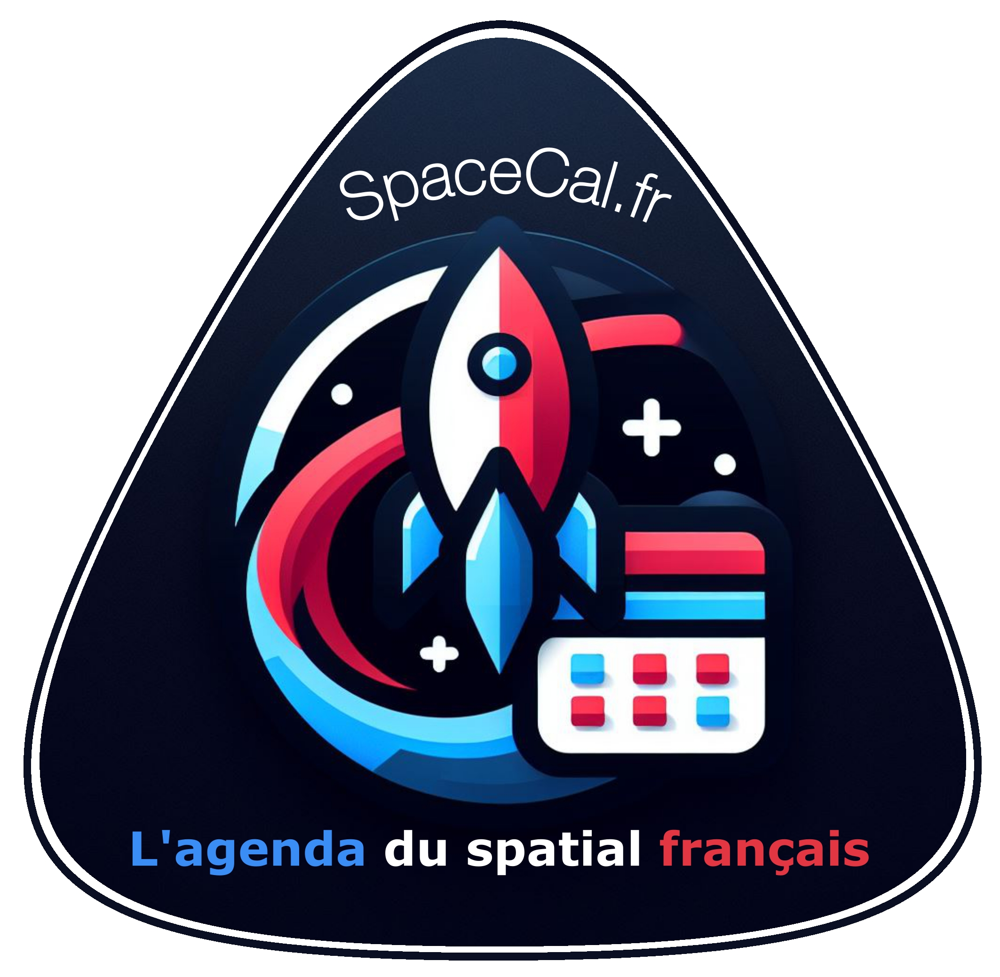

# SpaceCal-Fr - Agenda des événements du spatial du 9 au 15 novembre 2026

Bonsoir à toutes et tous,

C'est dimanche et voici votre rendez-vous hebdomadaire des nombreux et passionnants événements du spatial français de cette nouvelle semaine de novembre !

⤵️🧶❤️🛰️

## Lundi 9 novembre
3 événements [(tous les liens sur SpaceCal-Fr)](https://www.spacecal.fr) :

1. ***Transitions in the Space Field*** : conférence de deux jours, organisée par le laboratoire Junior Space Ages, en collaboration avec UNIVERSEH, Framespa et le CNES, qui réunira des chercheurs issus de différentes disciplines afin d’explorer les transformations en cours dans le secteur spatial.
Le programme comprendra des débats sur un large éventail de sujets mais également une table ronde sur le thème « *Les femmes et l’espace* », qui abordera les questions de genre, de représentation et d’inclusivité dans ce secteur.
Événement en ligne et en présentiel. Début à 9h15 à TBS Education, Toulouse (31).

2. ***UTIAS² 2026*** : 2e édition du Forum Usages des Technologies d’Intelligence Artificielle dans le Secteur Spatial (UTIAS²) dont l'objectif est d'offrir un point de rencontre et d'échanges entre les différents acteurs de l’écosystème autour de l'intelligence artificielle dans le secteur spatial français.
Début à 14h à La Cité, Toulouse (31).

3. ***Le fil d'Ariane*** : par Jean-Claude TRAÎNEAU, expert en propulsion solide et aérothermodynamique, dans le cadre des conférences du Groupe Occitanie de l'Association Aéronautique et Astronautique de France (3AF).
À 18h à l'ISAE Supaero, Toulouse (31).

## Mardi 10 novembre
3 événements [(tous les liens sur SpaceCal-Fr)](https://www.spacecal.fr) :

1. ***BepiColombo: Le Grand Rendez-Vous*** : à l’occasion de l’arrivée de BepiColombo, la mission spatiale dédiée à l'étude de Mercure, cet événement réunira les différents acteurs et actrices ayant contribué à donner vie à cette mission.
Au programme : plusieurs courts métrages présenteront différents aspects de la mission BepiColombo, une séance de questions-réponses avec les réalisateurs de l’un des courts métrages et des interventions scientifiques données par des chercheurs et chercheuses ayant activement contribué à la mission. 
Dès 15h30 au Campus Pierre et Marie Curie (Jussieu), Paris (Ve).

2. ***Les enjeux spatiaux européens, quelles perspectives ?*** : par Charles-Henri Du Che, conseiller défense auprès du PDG d’Ariane Group, dans le cadre des conférences mensuelles de la Société Astronomique de Bourgogne.
Début à 18h30 à l'amphithéâtre Claude Bernard, Faculté des Sciences Mirande, Dijon (21).

3. ***Astrophysiques : L’intelligence artificielle, la science et la société*** : par Simon Dupourqué, chercheur postdoctoral à l’Institut de Recherche en Astrophysique et Planétologie, étudiant l’utilisation de l’apprentissage machine pour l’astrophysique des hautes énergies, dans le cadre des conférences UniversCiel. À 20h30 au Café l'Astronef, Toulouse (31).

## Jeudi 12 novembre
3 événements [(tous les liens sur SpaceCal-Fr)](https://www.spacecal.fr) :

1. ***L’alimentation des astronautes*** : par Roxane Coiffet, nutritionniste au MEDES, et Alain Maillet, chef de projet au MEDES, tous deux responsables de l’expérience FoodProcessor, qui présenteront comment sont élaborés les repas des astronautes lors de leur mission à bord de l’ISS. 
Webconférence accessible aux enseignants et élèves des cycles 3 et 4 et du lycée. 
Durée : 30 minutes et suivie d’une session de questions/réponses de 10 minutes.
Dès 14h en ligne.

2. ***AoT Paris - Observing the highest energy light in the Universe...*** : ..."*from stellar graveyards to super massive black holes.*"
Par la Dr. Lea Heckmann et la Dr. Kirsty Feijen.
Deux chercheuses, deux exposés, une bière à la main. 
Entrée libre, aucune connaissance en astronomie requise, et toutes les questions sont les bienvenues. Début à 19h à The Dissident Club, Paris (IXe).

3. ***Constellation et Artemis : le grand retour sur la Lune*** : par Olivier de Goursac, spécialiste du retraitement d’images spatiales et des missions Apollo, vice-président de la Commission de planétologie de la SAF, dans le cadre d'un cycle de conférences de l'Université Populaire d’Antony. À 20h30 à la Salle du Mont Blanc, Antony (92).

## Vendredi 13 novembre
3 événements [(tous les liens sur SpaceCal-Fr)](https://www.spacecal.fr) :

1. ***Rencontres du Ciel et de l'Espace - RCE 2026*** : 15e édition du rendez-vous incontournable des passionnés et des curieux du ciel avec sa braderie, ses conférences, ses forums techniques, ses dédicaces et son salon où l'ensemble de la profession se rassemble pour présenter les dernières nouveautés.
Jusqu'au 15 novembre à la Cité des Sciences et de l'Industrie, Paris (XIXe).

2. ***Astr’automne*** : 6e édition du festival d'astronomie de Juvisy Astr'Automne organisé par le club Nova Astronomie Juvisy.
Au programme : stands, ateliers pour petits et grands et conférences pour améliorer ses connaissance de l’Univers.
Jusqu'au 15 novembre à l'Espace Jean Lurçat, Juvisy-sur-Orge (91).

3. ***La recherche de vie extraterrestre*** : par Frédéric Foucher, physicien, ingénieur de recherche CNRS au laboratoire Conditions Extrêmes et Matériaux : Haute Température et Irradiation (CEMHTI) d’Orléans, dans le cadre des conférences de la Société d'astronomie de Nantes (SAN).
Début à 21h à la Salle Notre-Dame de toutes aides, Nantes (44).

## Samedi 14 novembre
3 événements [(tous les liens sur SpaceCal-Fr)](https://www.spacecal.fr) :

1. ***NASA Space Apps Challenge 2026 - Toulouse*** : le NASA Space Apps Challenge offre à toute personne intéressée par l'espace et les sciences la possibilité de relever des défis concrets à travers un hackathon annuel réalisé simultanément dans plusieurs viles du monde.
Le « *Space Apps Challenge* » annuel offre la possibilité d'exploiter directement les données de la NASA, ainsi que celles des agences spatiales partenaires. 
Au cours de ce hackathon de deux jours, les équipes utilisent ces données pour relever des défis définis par des experts de la NASA, portant notamment sur la narration, le développement logiciel, l'astrophysique, l'exploration spatiale, l'agriculture et bien d'autres thèmes encore.
Jusqu'au 15 novembre à l'IPSA Toulouse (31).

2. ***Constellation Graphique hors les murs*** : en écho au lancement de l’ouvrage « *L’architecture rationaliste à Nice* », la Ville donne carte blanche à Sylvie T pour présenter les oeuvres nées de sa résidence d’artiste entre science et patrimoine, d’octobre 2025 à mai 2026 à l’Observatoire de la Côte d’Azur, sur le site du Mont-Gros.
Soutenue par la DRAC (Direction Régionale des Affaires Culturelles) Provence-Alpes-Côte d’Azur, dans le cadre du programme Culture et lien social.
Début à 11h au Centre du Patrimoine – Le Sénat, Nice (06).

3. ***Les astéroïdes et le système Fripon*** : par Karl Antier, géophysicien et médiateur scientifique du Comptoir des Étoiles, dans le cadre des conférences de la Société Astronomique de Lyon.
Dès 17h30 à la Salle Gayet - Complexe de la Mouche, Saint Genis Laval (69).

---

Voilà, l'actualité prévisionnelle c'est terminé pour ce soir 😉

Retrouvez **l'intégralité des liens vers les sites officiels des événements cités** ainsi que tous les autres événements à venir sur nos flux et notre site Internet [https://www.spacecal.fr](https://www.spacecal.fr/)

Merci de nous avoir lu, **n'hésitez pas à republier cette lettre pour en faire profiter le plus grand nombre**, à bientôt et très bonne semaine à vous... 🖖
