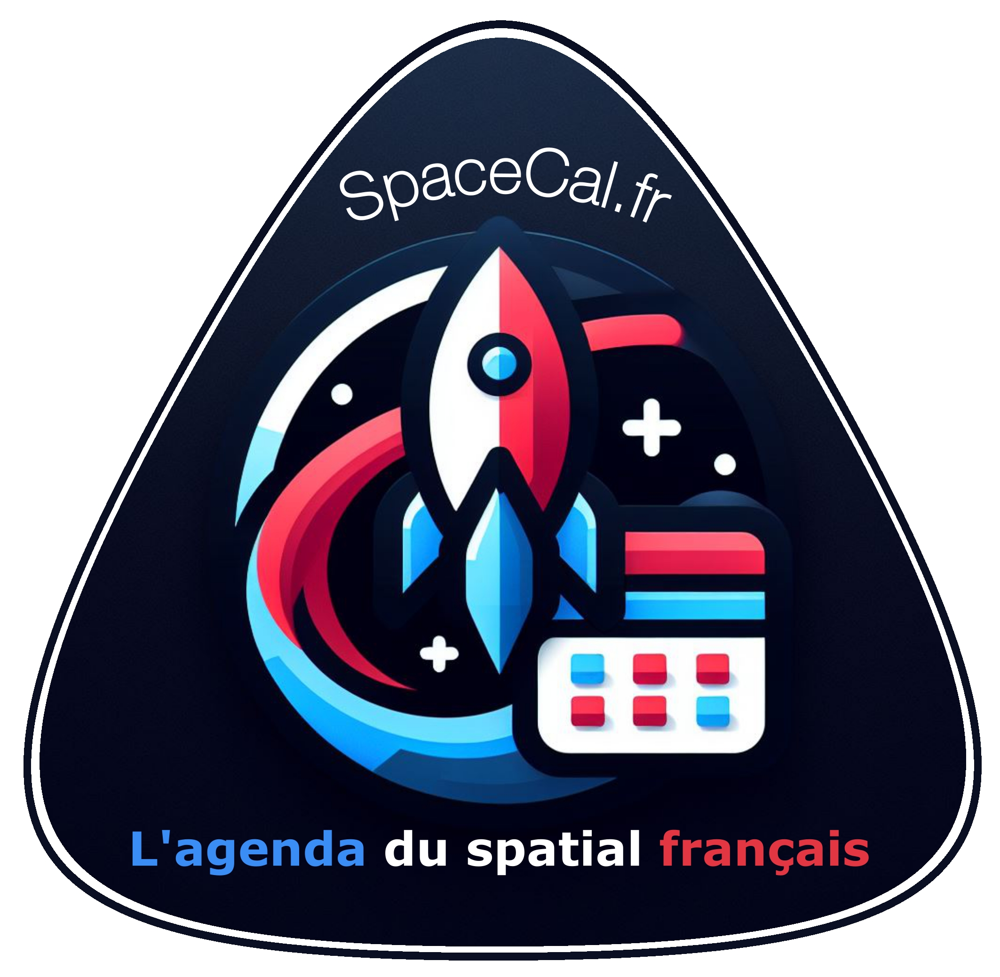

# SpaceCal-Fr - Agenda des événements du spatial du 16 au 22 novembre 2026

Bonsoir à toutes et tous,

C'est dimanche et voici votre rendez-vous hebdomadaire des nombreux et passionnants événements du spatial français de cette nouvelle semaine de novembre !

⤵️🧶❤️🛰️

## Lundi 16 novembre
8 événements [(tous les liens sur SpaceCal-Fr)](https://www.spacecal.fr) :

1. ***PCMI2026 - Colloque de l'action thématique Physique Chimie du Milieu Interstellaire 2026*** : Colloque annuel de l'action thématique Physique Chimie du Milieu Interstellaire (PCMI) qui anime la recherche entre physiciens, chimistes et astrophysiciens afin de faire progresser la compréhension des environnements interstellaires et circumstellaires de notre galaxie et d'autres galaxies.
L'Action thématique PCMI est un programme par projet du CNRS/INSU, également soutenu par le CNRS/INP, le CNRS/INC, le CNES et le CEA
Jusqu'au 19 novembre à Le Village, Toulouse (31).

2. ***Le spatial : de la recherche aux applications industrielles - Session 1*** : dans le cadre des 5e Rencontres du spatial en région Sud, la CISAM, CISAM+ et Aix Marseille Université, en collaboration avec le CNES, proposent de découvrir le secteur spatial, de la recherche aux applications industrielles.
Au programme : une présentation du CNES et la visite d’un showroom consacré aux technologies spatiales, avec des démonstrations de robotique, d’instrumentation, des modules embarqués à bord de la Station spatiale internationale (ISS) et des expériences en biologie.
Deux sessions sur inscription. 
La première à 10h et la seconde à 11h au CISAM - Accélérateur M, Marseille (13).

3. ***SCO World Virtual Congress*** : coordonné par le Secrétariat de l'OCS, ce premier Congrès mondial virtuel rassemble pendant cinq jours, des agences spatiales, des institutions, des scientifiques, des entreprises et des acteurs locaux autour d’un objectif commun : partager des solutions, des expériences et des initiatives collaboratives visant à transformer les données spatiales en outils concrets pour s’adapter au changement climatique.
Chaque session a été conçue en fonction d’une région spécifique du monde, en tenant compte de son fuseau horaire et de ses propres défis climatiques.
Une semaine. 12 sessions. Un tour d'horizon mondial des solutions spatiales pour l'adaptation au changement climatique.
Sessions en français et en anglais.
Dès 12h en ligne.

4. ***Colloque G2 - Une planète sur mesure*** : organisé par l'Institut de Physique du Globe de Paris (IPGP), le colloque G2 réunit la communauté afin de présenter et d'échanger des résultats scientifiques d’actualité et de communiquer sur les enjeux nationaux et internationaux dans ses thématiques.
Cette année, des présentations orales et des posters sont sollicités sur les thèmes suivants : géodésie et gravimétrie spatiales, systèmes de référence, déformations de la Terre, interactions entre le changement climatique et la Terre solide, hydro-géodésie, télédétection, instrumentation, capteurs quantiques, observations du Système Terre et infrastructures de recherche.
À 13h à l'Institut de Physique du Globe de Paris (IPGP), Paris (Ve).

5. ***L'Univers lointain sondé par les quasars*** : par Patrick Boisse, professeur émérite Sorbonne Université, astrophysicien IAP, dans le cadre du cycle de conférences concernant l'astronomie et les disciplines voisines du Club de Vulgarisation Scientifique.
Début à 19h à l'ENSAM, Paris (XIIIe).

6. ***Recherche académique et spatial - Visite du LAM*** : Le Laboratoire d'Astrophysique de Marseille (LAM) ouvre ses portes aux professionnels pour une visite guidée de ses infrastructures. 
Au programme : découverte des laboratoires où sont conçues et testées les optiques spatiales, des instruments et logiciels développés pour les missions comme Euclid ou SVOM, et échanges avec les équipes sur les défis technologiques et les projets futurs du LAM.
Événement organisé dans le cadre des 5e Rencontres du Spatial dans les Bouches-du-Rhône (13).
Sur inscription auprès du Laboratoire d'Astrophysique de Marseille (13).

7. ***Terre à l'Horizon : les rêves d'Espace face aux Limites Planétaires*** : avant-première du long-métrage documentaire contemplatif et poétique, réalisé de janvier à septembre 2026, grâce au soutien d'Aéro Décarbo, Eutelsat, IGN et 95 contributeur/rices Ulule.
Réalisé et scénarisé par Eliott Marceau et Hugo Le Dirach, ce documentaire invite les spectateurs à questionner leur rapport à l’exploration spatiale et à notre planète, à travers une réflexion originale portée par un groupe de jeunes passionné(e)s de cinéma et d’Espace, qui sillonnent l'Europe sur les rails.
Une question centrale guide leur réflexion : « *𝑃𝑒𝑢𝑡-𝑜𝑛 𝑒𝑛𝑐𝑜𝑟𝑒 𝑟𝑒̂𝑣𝑒𝑟 𝑑’𝐸𝑠𝑝𝑎𝑐𝑒, 𝑎̀ 𝑙’𝑒̀𝑟𝑒 𝑑𝑒 𝑙𝑎 𝑐𝑟𝑖𝑠𝑒 𝑒́𝑐𝑜𝑙𝑜𝑔𝑖𝑞𝑢𝑒 ?* »
Un documentaire qui ouvre le débat sur les rêves d’exploration spatiale et les limites planétaires.
Début à 19h45 au Pathé Wilson, Toulouse (31).

## Mardi 17 novembre
7 événements [(tous les liens sur SpaceCal-Fr)](https://www.spacecal.fr) :

1. ***SAGÉO 2026 (Spatial Analysis and GEOmatics)*** : événement annuel du domaine des sciences des données spatiales, organisé par le Groupement de Recherche MAGIS du CNRS, qui vise à présenter les dernières avancées dans les domaines de la géomatique, de la modélisation et de l’analyse spatiale. 
Dès 9h à l'INP-AgroToulouse (ENSAT), Toulouse (31).

2. ***Énergie noire : une constante inconstante ?*** : par Pauline Zarrouk, cosmologiste au Laboratoire de Physique Nucléaire et de Hautes Energies (LPNHE - CNRS/IN2P3 - SU - UPCité) de Sorbonne Université, dans le cadre des grands séminaires de l'Observatoire Midi-Pyrénées (OMP). Début à 11h à l'OMP - salle Coriolis, Toulouse (31).

3. ***Voir au-delà du visible : comment la poussière des étoiles redessine notre carte de la Voie Lactée*** : par Doug Marshall, maître de conférences en astrophysique, dans le cadre d'une conférence donnée en marge du congrès scientifique "Physique Chimie du Milieu Interstellaire 2026" de Toulouse.
Conférence suivie d'un échange entre le public et le conférencier, mais aussi avec d'autres scientifiques qui participent au congrès.
À 18h à la Salle des Bateliers, Toulouse (31).

4. ***Des galaxies monstres cachées dans le bruit des images astronomiques*** : par Samuel Boissier, astrophysicien au Laboratoire d'Astrophysique de Marseille, dans le cadre des conférences de l'Observatoire Astronomique du Gros Cerveau.
Début à 18h30 à l'Espace Brémond, Ollioules (83).

5. ***ASTRES Space Drink - Toulouse-Paris-Bordeaux*** : 3 afterworks de l'alliance ASTRES qui donne rendez-vous aux étudiants, jeunes diplômés, passionnés ou professionnels du secteur spatial pour une soirée réseau sous le signe de la convivialité.
L'objectif est simplement de se retrouver, d'échanger sur ses projets et de rencontrer de nouvelles têtes. 
En simultané dans 3 villes.
À 19h à The Black Owl, Toulouse (31).
À 19h à Madame Pervenche, Paris (IIIe).
À 19h à L’Engrenage, Bordeaux (33).

## Mercredi 18 novembre
4 événements [(tous les liens sur SpaceCal-Fr)](https://www.spacecal.fr) :

1. ***Matinée du Spatial à Sophia Antipolis*** : matinée d'échanges consacrée aux grands enjeux du NewSpace et de l'économie spatiale. 
Au programme : découverte de l'écosystème spatial de Sophia Antipolis, tables rondes sur les défis du NewSpace et la valorisation des données spatiales, suivies d'un cocktail networking.
Organisée dans le cadre des 5e Rencontres du Spatial en Région Sud par la Communauté d'Agglomération Sophia Antipolis (CASA), ACRI-ST, MED'Innov et Orus, cette édition mettra en lumière l'écosystème spatial azuréen, ses entreprises innovantes et les défis auxquels fait face la filière.
Dès 9h à Alpha Sophia Antipolis, Biot (06).

2. ***La photographie aérienne et spatiale : entre héritage et usages contemporains*** : colloque de trois jours d’échange et de découverte intitulé organisé par le musée de l’Air et de l’Espace et qui vise à aborder la question centrale de la photographie aérienne et spatiale comme outil scientifique, artistique et patrimonial, pour produire et structurer une représentation du fait aérien, tout en renouvelant notre regard sur les territoires et leurs usages.
Une exposition de tirages de photographie aérienne inédite est proposée du dimanche 15 novembre 2026 au dimanche 14 février 2027 dans le cabinet des affiches de la Grande Galerie et à l’entrée de la médiathèque.
Ce projet est labellisé Bicentenaire de la Photographie par le ministère de la Culture et s’inscrit dans la programmation officielle du Bicentenaire du 1er septembre 2026 au 30 septembre 2027.
Début à 10h au Musée de l'Air et de l'Espace, Le Bourget (93).

3. ***La formation et la diversité des systèmes planétaires*** : par Sean RAYMOND, Directeur de recherche CNRS - LAB, dans le cadre des conférences mensuelles de la société astronomique de Bordeaux.
Dès 18h30 à l'Hôtel des sociétés savantes, Bordeaux (33).

4. ***Des ballons pour la science*** : par Mélanie Ghysels-Dubois, directrice adjointe de l’infrastructure nationale IN AIR, et Vincent Dubourg, sous-directeur en charge des activités ballons au CNES, dans le cadre du cycle Rendez-vous Espace organisé avec les Amis de la Cité de l'espace et l'Association Aéronautique et Astronautique de France.
Début à 19h à la Cité de l'Espace, Toulouse (31).

## Jeudi 19 novembre
9 événements [(tous les liens sur SpaceCal-Fr)](https://www.spacecal.fr) :

1. ***5ᵉ rencontres du spatial en Région Sud*** : 5e édition des Rencontres du Spatial en région Sud qui réunissent les acteurs de la filière autour d’une journée de conférences, de tables rondes, de rencontres professionnelles, de présentations d’écosystèmes et de rendez-vous BtoB.
Une journée pour partager les grandes évolutions du secteur, découvrir les dynamiques de l’écosystème spatial et favoriser les rencontres entre industriels, institutionnels, académiques et acteurs de l’innovation.
Début à 8h30 au Palais des Festivals, Cannes (06).

2. ***Atelier Cesam2k20 IV*** : "*Modélisation des composants d’un système d’étoiles multiples à exoplanète*"
4e atelier de la communauté d'utilisateurs du code d'évolution stellaire Cesam2k20.
Cette année les sessions seront organisées autour du système TOI 858, un système double observé par TESS composé d'étoiles de 1.15 et 1.1 masses solaires. Autour du composant B orbite une Jupiter chaude de 1.1 masse de Jupiter. 
Ce système permettra donc d'illustrer des applications très variées de la modélisation. 
Atelier accessible aux débutants comme aux utilisateurs confirmés. Jusqu'au 20 novembre au Centre de conférences Jules Janssen, Meudon (92).

3. ***Agilité - DevOps*** : journée coorganisée par la COMET SIL et la CADOC (Cellule Agilité DevOps du CNES) avec pour thème principal : "*l’évolution de l'organisation des équipes avec les nouveaux paradigmes : Agilité, DevOps, Cloud...*"
La journée s'articulera autour de plusieurs formats : mini-conférences de 20 min avec séances de questions-réponses, ateliers, table ronde...
Dès 09h au CNES - Centre Spatial de Toulouse (31).

4. ***Du centre de contrôle au satellite : Nouveaux défis de la cybersécurité spatiale*** : à l'occasion de l'European Cyber Week (16 au 19/11), cette journée permettra de réunir des acteurs académiques, industriels et institutionnels européens pour développer les vecteurs d’innovation des territoires afin d’assurer la souveraineté des infrastructures critiques. 
Le matin, un focus sur les enjeux de cybersécurité du segment sol sera réalisé. L’après-midi sera dédiée à la sécurité du segment bord. 
Les stratégies seront détaillées dans une keynote et deux tables rondes.
À partir de 9h au Couvent des Jacobins, Rennes (35).

5. ***Job Dating - Défense, Aéronautique & Spatial*** : 5e édition du Job Dating Défense, Aéronautique & Spatial, un événement unique où talents et recruteurs se rencontrent pour créer les opportunités de demain.
Lors de cet événement, il sera possible d'échanger directement avec les entreprises leaders de la défense, de l'aéronautique et du spatial, de découvrir les métiers de demain et de saisir des opportunités de recrutement dans des domaines qui combinent technologie de pointe et innovation.
Début à 10h à La Cité, Toulouse (31).

6. ***Découvrez nos métiers de la Cybersécurité, de l’Imagerie Satellitaire et de l’A400M, dans le domaine de la défense*** : 15e édition de la Semaine de l'Industrie (SEDI) l'événement incontournable pour promouvoir un secteur en constante transformation. Cette initiative vise à valoriser les métiers de l’industrie et à renforcer leur attractivité, en particulier auprès des jeunes filles.
À l’occasion de cette semaine, Elles bougent mobilise ses partenaires pour proposer des événements immersifs et inspirants, destinés aux collégiennes, lycéennes et étudiantes avec un focus particulier sur le secteur de la Défense, structuré autour de plusieurs grands domaines d'activité : Terrestre / Maritime / Aéronautique / Spatial / Cyberdéfense et numérique. À 13h15 à Airbus Defence and Space, Toulouse (31).

7. ***Space Academy MEETUP*** : évènement qui rassemblera pour la 1re fois la communauté de l’Académie Spatiale d’Île-de-France 
Au programme de cette soirée : rencontres, partage d’expériences, création de nouvelles synergies et célébrations autour d’un cocktail.
Début à 18h au Campus des Cordeliers, Paris (VIe).

8. ***Cinema for Space*** : 2e édition de ce festival international de cinéma consacré au spatial qui proposera pendant quatre jours : des projections, des débats, des masterclass et des rencontres inédites entre grands noms du cinéma et experts scientifiques.
Au delà du festival de films, CINEMA FOR SPACE est également un lieu de dialogue entre science, cinéma et société, avec de nombreux débats autour de sujets d’actualité, comme la préservation de l’espace spatial ou l’essor des satellites.
Avec un programme Jeunesse, un prix du public et un prix d’honneur, le festival veut s’adresser à toutes les générations.
Début à 19h au Palais des festivals, Cannes (06).

9. ***La Lune, nouvel enjeu géopolitique*** : par la Dre Isabelle Sourbès Verger, géographe et directrice de recherche au CNRS, dans le cadre d'un cycle de conférences de l'Université Populaire d’Antony. À 20h30 à la salle du Mont Blanc, Antony (92).

## Vendredi 20 novembre
1 événement [(tous les liens sur SpaceCal-Fr)](https://www.spacecal.fr) :

1. ***Exoplanètes et science-fiction*** : par Franck Selsis, directeur de recherche CNRS/LAB, dans le cadre des conférences mensuelles de l'association Jalle Astronomie.
Début à 21h à la Maison des Gestes du Développement Durable (MGDD), Martignas-sur-Jalle (33).

## Samedi 21 novembre
3 événements [(tous les liens sur SpaceCal-Fr)](https://www.spacecal.fr) :

1. ***Masterclass " OSER L'ESPACE"*** : masterclass avec Érika Vélio pour explorer les opportunités, de La Réunion à l'international.
Pendant quatre heures, en petit comité, cette session propose de travailler sur vos ambitions, votre leadership et votre capacité à passer à l’action.
Avec un workbook dédié et une feuille de route personnelle à 90 jours.
À destination des étudiants, jeunes diplômés, professionnels, cadres, entrepreneurs et personnes en transition qui souhaitent explorer de nouvelles possibilités et donner une nouvelle dimension à leur parcours.
Dès 9h à Dina Morgabine, Saint-Denis (974).

2. ***Journée des métiers de l'astronomie et du spatial (JMAS)*** : la Commission Jeunes de la Société astronomique de France avec l’association Alcor organise la première Journée des Métiers de l’Astronomie et du Spatial (JMAS).
Pendant une journée entière, des professionnels et des doctorants présentent leur parcours scolaire, universitaire et professionnel, et répondent aux questions du public.
Un évènement formidable pour envisager des études supérieures à la croisée des chemins de la science, des technologies et de l'aventure, au service des Connaissances et de la Recherche.
À destination des lycéens et lycéennes, étudiants et étudiantes, aux personnes intéressées par les métiers de l'astronomie et du spatial.
Début à 9h à l'Université Paris-Saclay - Bâtiment 625, Orsay (91), avec retransmission en direct sur la chaine YouTube de la SAF.

3. ***Les pionnières de l'astronomie*** : par Nadège Lagarde, chercheure au Laboratoire d'astrophysique de Bordeaux, dans le cadre de la conférence annuelle de l'association ASTROSAUCATS.
À 18h à la salle de "La Ruche", Saucats (33).

---

Voilà, l'actualité prévisionnelle c'est terminé pour ce soir 😉

Retrouvez **l'intégralité des liens vers les sites officiels des événements cités** ainsi que tous les autres événements à venir sur nos flux et notre site Internet [https://www.spacecal.fr](https://www.spacecal.fr/)

Merci de nous avoir lu, **n'hésitez pas à republier cette lettre pour en faire profiter le plus grand nombre**, à bientôt et très bonne semaine à vous... 🖖
